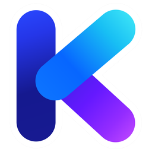
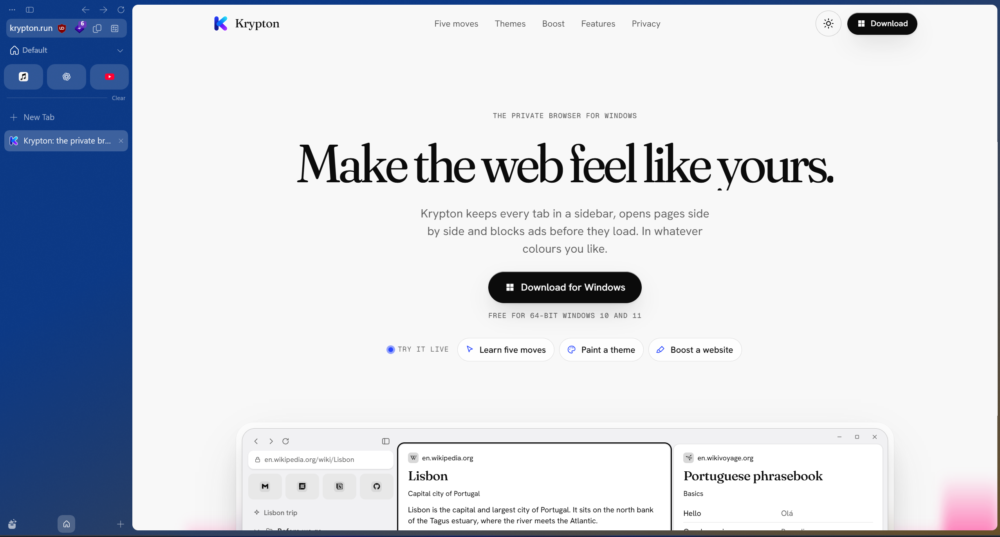

<p align="center">
  
</p>

<h1 align="center">KryptonUI</h1>

<p align="center">
  <strong>The native Windows interface of Krypton Browser: vertical tabs, workspaces, a command bar and window controls, built with WinUI 3 and modern C++.</strong>
</p>

<p align="center">
  <a href="https://krypton.run/download/"><strong>Download Krypton for Windows</strong></a>
  ·
  <a href="https://krypton.run">Website</a>
  ·
  <a href="https://github.com/perpetus/Krypton">Krypton Browser</a>
</p>

<p align="center">
  
  
  
  <a href="LICENSE"></a>
</p>

<p align="center">
  
</p>

KryptonUI is everything you touch in [Krypton](https://github.com/perpetus/Krypton)
that isn't the web page: the sidebar, tabs, workspaces, address field, menus,
command bar and window controls. It's built with native Windows controls rather
than web views, so it follows Windows motion, high contrast and text scaling.

## What it brings to Krypton

- **A place for every tab:** vertical and horizontal tabs, Spaces, folders,
  Live Folders and pinned Essentials.
- **Space to focus:** compact layouts, split-view controls and Glance previews.
- **Fast navigation:** a command bar for tabs, Spaces, history, bookmarks and
  browser actions, plus Ctrl+Tab previews of up to five tabs.
- **Tools within reach:** the address field, Tools menu, Library, downloads and
  media controls.
- **A look that feels personal:** workspace themes, icon choices and site
  appearance controls through Boosts.

## How it's built

KryptonUI is organized like a multiplatform app:

- **One common C++23 layer** holds all behaviour: state, ordering, layout maths
  and what gets drawn.
- **A thin native layer per platform** draws it. Windows uses WinUI 3 through
  the Windows App SDK and C++/WinRT.
- **A plain C contract** in
  [`modules/abi/include/krypton_ui/abi.h`](modules/abi/include/krypton_ui/abi.h)
  is the only way the browser talks to it.

The interface runs on the browser's UI thread, so performance comes first. It
is designed to render only when something changes, update lists incrementally,
run animations on the compositor and stay idle when nothing happens. Colours, sizes,
radii and motion come from design tokens in [`design/tokens.json`](design/tokens.json).

## Building

On Windows, with Visual Studio's C++ tools, CMake and PowerShell 7:

```powershell
pwsh tools/dev.ps1 configure
pwsh tools/dev.ps1 build -Config Release
pwsh tools/dev.ps1 preview --dark --tabs 200
```

The production target is `kr_shell`, which builds `krypton_ui.dll`. The preview
runs the interface against a simulated browser.

## Related repositories

| Repository | What it holds |
| --- | --- |
| [Krypton](https://github.com/perpetus/Krypton) | The browser: Chromium changes, privacy features and build tools. |
| [KryptonUI](https://github.com/perpetus/KryptonUI) | The native interface (this repository). |
| [KryptonUpdater](https://github.com/perpetus/KryptonUpdater) | The Windows installers and signed automatic updates. |
| [krypton-windows](https://github.com/perpetus/krypton-windows) | Every release: installers, checksums, source archives and update packages. |

KryptonUI is part of Krypton and is developed alongside the browser.
[Credits and attribution](CREDITS.md) · [Third-party notices](THIRD_PARTY_NOTICES.md)
· [License](LICENSE)
